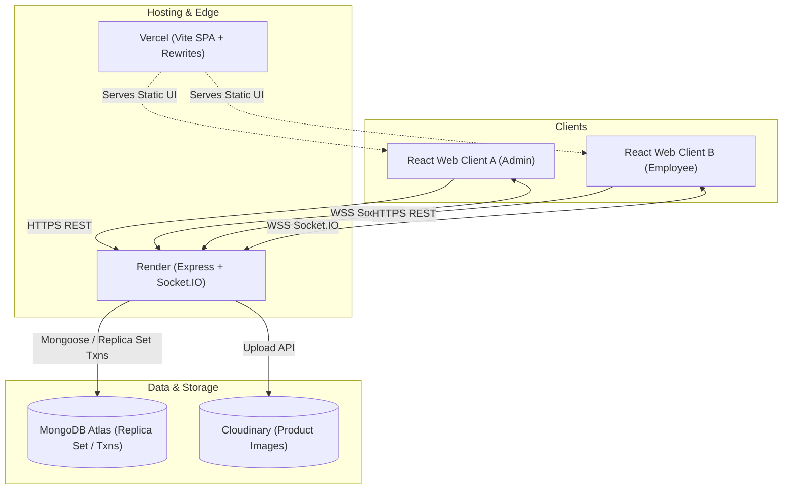

# SmartStock — Inventory, Purchasing & Real-Time Operations Control

> Production-ready, full-stack inventory management system built with Node.js, Express, Socket.IO, MongoDB, React, Vite, and Tailwind CSS.

[](https://github.com/your-username/smartstock/actions)
[](LICENSE)

---

## 🌟 Live Demo & Preview

- **Live Web App**: [https://smartstock-web.vercel.app](https://smartstock-web.vercel.app) *(Deploy link placeholder)*
- **API Status Endpoint**: [https://smartstock-api.onrender.com/health](https://smartstock-api.onrender.com/health) *(Deploy link placeholder)*

```
[ Dashboard Screenshot Placeholder: 1440x900 ]
```

---

## 🛠 Tech Stack

### Frontend (`apps/web`)
- **React 18** + **TypeScript** + **Vite**
- **Tailwind CSS** with custom dark/light token system (navy-900 / emerald accents)
- **TanStack Query (React Query v5)** for server state caching and optimistic UI updates
- **Socket.IO Client** for domain-driven real-time updates and query invalidation
- **Lucide React** icons & **Recharts** for analytics and inventory metrics
- **React Hook Form** + **Zod** for client-side and contract validation

### Backend (`apps/api`)
- **Node.js** + **Express** + **TypeScript**
- **MongoDB** + **Mongoose** (ACID multi-document transactions)
- **Socket.IO** (role-based rooms, token authentication, automated events)
- **Helmet**, **express-rate-limit** (strict auth throttling)
- **JWT** (access + refresh tokens with session revocation versioning)
- **Cloudinary** & local storage adapters for image handling

### Shared Package (`packages/shared`)
- Canonical TypeScript types, Zod schemas, role permissions map, and business invariants.

---

## 📐 System Architecture



---

## ⚡ Real-Time Synchronization (Socket.IO)

SmartStock uses a reactive event architecture:
1. Open the application in **two browser tabs** side-by-side:
   - Tab 1: Logged in as **Admin** (`admin@smartstock.dev`)
   - Tab 2: Logged in as **Employee** (`employee@smartstock.dev`)
2. In Tab 1, perform a **Stock-In** or **Stock-Out** operation.
3. Observe Tab 2:
   - Instantly receives the `stock:updated` Socket event.
   - TanStack Query cache is automatically invalidated.
   - The updated row displays a subtle emerald highlight for 2 seconds.
   - No manual page refresh is needed.
4. If a tab loses network connectivity, the socket automatically reconnects and triggers a background sync.

---

## 🔐 Role-Based Access Control (RBAC)

SmartStock strictly enforces permissions on both client routes and backend API endpoints:

| Feature / Action | Admin | Manager | Employee |
| :--- | :---: | :---: | :---: |
| View Products, Stock & Categories | ✅ | ✅ | ✅ |
| Record Stock In / Stock Out | ✅ | ✅ | ✅ |
| Inventory Audit & Stock Adjustment | ✅ | ✅ | ❌ |
| Manage Categories & Suppliers | ✅ | ✅ | ❌ |
| Create & Confirm Purchase Orders | ✅ | ✅ | ❌ |
| Receive Purchase Orders (Restock) | ✅ | ✅ | ❌ |
| View Financial Reports & CSV Export | ✅ | ✅ | ❌ |
| Manage System Users & Change Roles | ✅ | ❌ | ❌ |

---

## 🚀 Local Development Setup

### 1. Prerequisites
- Node.js 18+ & npm
- Docker (for MongoDB replica set transactions) or MongoDB 6.0+ replica set

### 2. Clone and Install
```bash
git clone https://github.com/your-username/smartstock.git
cd smartstock
npm install
```

### 3. Start Database
```bash
# Starts MongoDB in single-node replica set mode (needed for transactions)
docker compose up -d mongo
```

### 4. Configure Environment
```bash
cp .env.example apps/api/.env
```

### 5. Seed Demo Data
```bash
npm run seed
```

### 6. Run Development Servers
In separate terminals:
```bash
# Terminal 1: Start API
npm run dev:api

# Terminal 2: Start Web UI
npm run dev:web
```

---

## 👥 Demo Credentials

| Role | Email | Password |
| :--- | :--- | :--- |
| **Admin** | `admin@smartstock.dev` | `Passw0rd!` |
| **Manager** | `manager@smartstock.dev` | `Passw0rd!` |
| **Employee** | `employee@smartstock.dev` | `Passw0rd!` |

---

## ⚠️ Known Limitations

1. **Free-tier Sleep**: Render's free tier spins down after 15 minutes of inactivity; initial cold start can take 30–50s.
2. **MongoDB Transactions**: Atomic multi-document operations (Stock movements + Quantity sync) require a replica set.
3. **Local Uploads**: When `CLOUDINARY_URL` is omitted, uploads are stored locally in `apps/api/uploads`.
